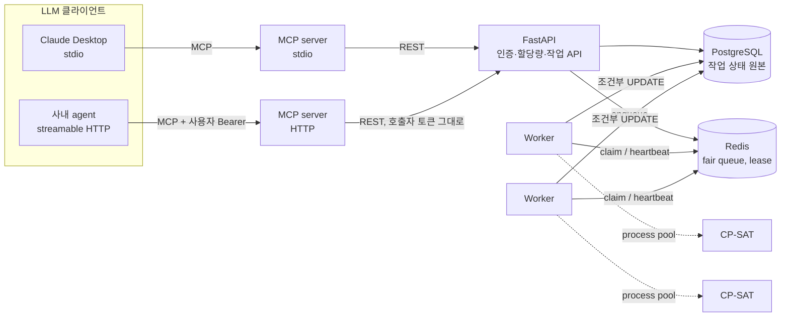

# Factory Scheduling Agent

LLM agent가 MCP tool로 공장 생산 일정을 최적화·재계산하게 하는 백엔드.

```
"주문 20건, 압출기 4대, 납기 금요일. 일정 짜줘"
"EXT-2 스크류 파손, 8시간 정지. 이미 돌고 있는 건 두고 다시 짜줘"
```

LLM은 요청을 `ScheduleProblem`으로 바꿔 tool을 호출하고, 백엔드는 CP-SAT 최적화 작업을 큐에 넣어 워커에서 실행한다.
여러 사용자가 동시에 무거운 최적화 작업을 던져도 사용자별 할당량과 fair queuing으로 자원을 나눈다.

## 배경

운영 중인 제조 MES에서 생산계획은 담당자가 날짜·설비를 직접 입력하는 방식이었다.
MES는 "무엇을 얼마나 만들지"(MRP)는 계산하지만 "어느 설비에서 언제 만들지"는 사람이 정한다.
이 프로젝트는 그 빈칸을 최적화 엔진으로 채우고, 현장 변경(고장·긴급 주문)에 대한 재계산을 자연어로 요청할 수 있게 한다.

## 결과

### 최적화 품질 — 사람의 규칙 대비

비교 기준: 납기가 빠른 주문부터 가장 빨리 끝나는 설비에 붙이는 규칙 (엑셀로 계획을 짤 때 쓰는 방식).
필름 압출 공장 모델(설비별 가능 제품·속도 상이, 원료 계열 교체 시 20~120분 세팅), seed 10개 평균, time limit 10s, 8 threads.

| 주문 × 설비 | 납기 지연 주문 (규칙 → 최적화) | 가중 납기 지연 감소 | 세팅 시간 | 전체 완료 | OPTIMAL 증명 | 평균 solve |
|---|---|---|---|---|---|---|
| 10 × 3 | 3.1 → 2.1 | **54%** | 327 → 282 분 | 41.2 → 37.6 h | 10 / 10 | 0.2 s |
| 20 × 4 | 7.1 → 4.3 | **56%** | 635 → 476 분 | 63.5 → 57.2 h | 7 / 10 | 5.5 s |
| 40 × 5 | 15.0 → 8.5 | **53%** | 1005 → 847 분 | 101.1 → 90.5 h | 1 / 10 | 9.6 s |

재현: `python scripts/benchmark.py --seeds 10 --sizes 10x3 20x4 40x5 --time-limit 10`

### 다중 사용자 부하

8명이 동시에 작업 3개씩(20주문 문제, time limit 3s) 제출. 워커 슬롯 4 × CP-SAT 2 threads, 사용자당 동시 실행 1. 로컬 8코어, SQLite.

| 지표 | 개선 전 | 개선 후 | 원인 / 조치 |
|---|---|---|---|
| 제출 응답 p95 | 4451 ms | 413 ms | PBKDF2 해시가 이벤트 루프를 막음 → `asyncio.to_thread` |
| 사용자별 첫 작업 최대 대기 | 19.0 s | 5.4 s | 먼저 몰아 넣은 사용자가 대기열 독점 → 가상 시각 기반 fair queuing |
| 처리량 | 45 jobs/min | 72 jobs/min | 위 두 조치의 결과 |
| 실패 | 0 / 24 | 0 / 24 | |

재현: `python scripts/loadtest.py --users 8 --jobs-per-user 3 --orders 20 --time-limit 3`

## 구성



| 구성 요소 | 역할 |
|---|---|
| `factory_agent/solver` | 문제 스키마, CP-SAT 모델, 기준 휴리스틱, 제약 검증기, 문제 생성기 |
| `factory_agent/api` | REST API: 인증(JWT), 작업 제출·조회·취소·재계산, 피드백, 관리자 통계 |
| `factory_agent/queue.py` | Redis 큐: 우선순위, fair queuing, 사용자별 동시 실행 한도, lease, 재시도 |
| `factory_agent/worker.py` | 작업 실행: process pool solve, heartbeat, 만료 lease 회수, graceful shutdown |
| `factory_agent/mcp_server.py` | MCP tool 8종. stdio(1인) / streamable HTTP(다중 사용자, 토큰 전달) |
| `factory_agent/reschedule.py` | 기존 일정 + 현장 변경 → 새 문제 (착수 작업 고정) |

설계 결정과 트레이드오프는 [docs/architecture.md](docs/architecture.md).

## 최적화 모델

| 항목 | 내용 |
|---|---|
| 결정 변수 | 주문별 시작 시각, 가능한 설비별 배정 여부 |
| 제약 | 주문당 설비 1대 · 설비별 비중첩 · 정지 구간 회피 · 자재 입고(release) 이후 시작 · 제품군 교체 시간(sequence-dependent, 설비별 circuit) · 착수 작업 고정 |
| 목적 | `tardiness 가중치 × Σ(주문 가중치 × 지연 분) + makespan 가중치 × 전체 완료 시각` |
| 초기 해 | 기준 휴리스틱 해를 hint로 주입 |
| 안전장치 | solver 결과를 독립 검증기(`check_feasible`)로 다시 검사. 위반 시 결과를 내보내지 않음 |

## MCP tools

| tool | 용도 |
|---|---|
| `submit_schedule` | 문제 제출 → job id |
| `wait_for_job` / `get_job` | 완료 대기 / 상태·대기 순번·지표 요약 |
| `get_schedule` | 설비별 배정 결과 (설비 필터) |
| `reschedule` | 고장·긴급 주문·납기 변경 반영 재계산. `freeze_until`로 착수 작업 고정 |
| `compare_jobs` | 두 일정의 지표 비교, 이동한 주문 목록 |
| `list_my_jobs` | 최근 작업 |
| `submit_feedback` | 현장 사용 가능 여부 평가 (1~5, 태그) |

## API

`/docs`(Swagger)에서 전체 명세 확인.

| method | path | 설명 |
|---|---|---|
| POST | `/auth/register`, `/auth/token` | 가입, 토큰 발급 |
| POST | `/jobs` | 작업 제출 (202). 대기 작업 한도 초과 시 429 |
| GET | `/jobs`, `/jobs/{id}` | 목록, 상태 + 기준 대비 개선 요약 |
| GET | `/jobs/{id}/result`, `/jobs/{id}/problem` | 전체 일정, 입력 문제 |
| POST | `/jobs/{id}/cancel` | 대기·실행 중 취소 |
| POST | `/jobs/{id}/reschedule` | 변경 반영 재계산 (부모 작업 연결) |
| PUT | `/jobs/{id}/feedback` | 피드백 (사용자·작업당 1건, 덮어쓰기) |
| GET | `/admin/queue`, `/admin/feedback/summary` | 큐·작업 통계, 피드백 집계 (낮은 평가 목록 포함) |
| PUT | `/admin/users/{id}/limit` | 사용자별 동시 실행 한도 |

## 실행

### Docker (Postgres + Redis + API + 워커 2 + MCP HTTP)

```bash
cp .env.example .env
docker compose up --build
```

API `http://localhost:8000/docs`, MCP `http://localhost:8001/mcp`.

### 로컬 단일 프로세스 (Redis 없이)

`FSA_EMBEDDED=true`면 프로세스 내 fakeredis와 내장 워커를 쓴다.

```bash
pip install -e ".[dev]"
FSA_EMBEDDED=true uvicorn factory_agent.main:app --port 8000
```

### Claude Desktop 연결 (stdio)

```json
{
  "mcpServers": {
    "factory-scheduler": {
      "command": "/path/to/.venv/bin/python",
      "args": ["-m", "factory_agent.mcp_server"],
      "env": { "FSA_API_URL": "http://localhost:8000", "FSA_EMAIL": "me@example.com", "FSA_PASSWORD": "..." }
    }
  }
}
```

### 테스트

```bash
pytest -q
python scripts/mcp_http_smoke.py --mcp http://localhost:8001/mcp
```

| 테스트 | 검증 내용 |
|---|---|
| `test_solver.py` | 해의 제약 충족(독립 검증기), 기준 대비 비열위, 세팅·정지·고정·입고 제약, 입력 검증 |
| `test_queue.py` | 우선순위, fair share, 사용자 한도, 동시 claim 중복 없음, lease 만료 재시도·포기, 늦은 완료 무시 |
| `test_api.py` | 인증, 소유권(타인 작업 404), 할당량 429, 실행 중 취소 시 결과 폐기, 고장 재계산 시 착수 작업 고정, 관리자 API |
| `test_mcp.py` | tool 목록, agent 전체 흐름, HTTP 모드 호출자 토큰 검증·전달 |

CI(GitHub Actions): 단위 테스트(3.11/3.12) → 실제 Postgres·Redis 서비스로 API + 워커 2대 기동 후 부하 테스트 → Docker 빌드.

## 한계와 다음 단계

| 항목 | 현재 | 다음 |
|---|---|---|
| 공정 | 단일 공정 (주문 = 작업 1개) | 다공정 라우팅 (압출 → 인쇄 → 포장), 공정 간 대기 |
| 근무 | 24시간 가동 가정 | 근무 캘린더·교대 반영 |
| 스키마 변경 | 시작 시 `create_all` | Alembic 마이그레이션 |
| 실행 중 취소 | 결과만 폐기, solve는 끝까지 돎 | 워커에 취소 신호 전달해 조기 중단 |
| 자원 클래스 | CPU 큐 1개 | 큐 이름 단위로 GPU 워커 분리 (ML 대리모델 추론 등) |
| 관측 | 로그, 관리자 통계 | Prometheus 지표 (대기 시간, solve 시간, 큐 길이) |
