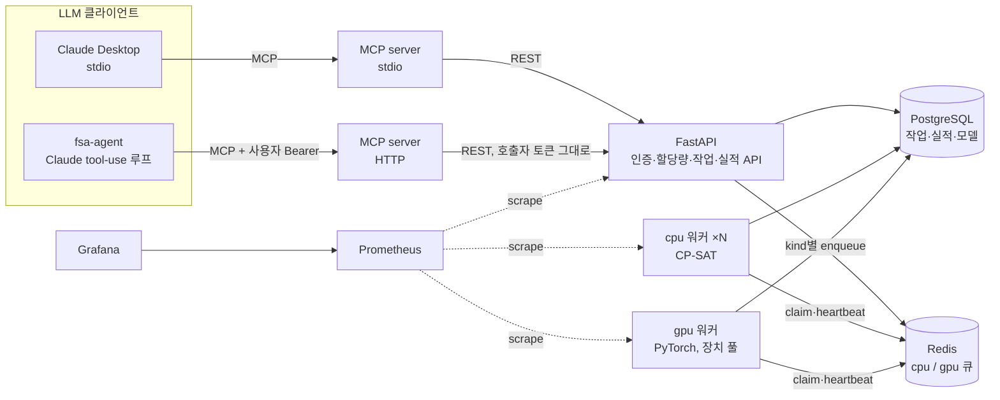

# Factory Scheduling Agent

LLM agent가 MCP tool로 공장 생산 일정을 최적화·재계산하게 하는 백엔드.

```
"주문 20건, 압출기 4대, 납기 금요일. 일정 짜줘"
"2호기 스크류 파손, 지금부터 8시간 정지. 이미 돌고 있는 건 두고 다시 짜줘"
```

- **agent**: Claude가 요청을 `ScheduleProblem`으로 바꿔 MCP tool을 호출하고 결과를 설명한다. 36개 케이스 평가 셋으로 변환 정확도를 잰다.
- **최적화**: CP-SAT. 설비 선택, 제품군 교체 시간, 고장 구간, 착수 작업 고정.
- **ML**: 과거 실적으로 소요 시간 예측 모델을 학습해, 정격 속도 대신 예측 시간으로 계획한다. 학습은 GPU 큐에서 돈다.
- **백엔드**: 다중 사용자 작업 큐(fair queuing, 사용자별 한도, lease 재시도), 자원 클래스별 워커(cpu/gpu), JWT, Alembic, Prometheus.

## 배경

운영 중인 제조 MES에서 생산계획은 담당자가 날짜·설비를 직접 입력하는 방식이었다.
MES는 "무엇을 얼마나 만들지"(MRP)는 계산하지만 "어느 설비에서 언제 만들지"는 사람이 정하고, 그 계산의 기준인 정격 속도는 실제와 다르다.
이 프로젝트는 그 두 빈칸(배치 최적화, 실제 소요 시간)을 채우고, 현장 변경에 대한 재계산을 자연어로 요청할 수 있게 한다.

## 결과

### 1. 최적화 품질: 사람의 규칙 대비

비교 기준: 납기가 빠른 주문부터 가장 빨리 끝나는 설비에 붙이는 규칙 (엑셀로 계획을 짤 때 쓰는 방식).
필름 압출 공장 모델, seed 10개 평균, time limit 10s, 8 threads.

| 주문 × 설비 | 납기 지연 주문 (규칙 → 최적화) | 가중 납기 지연 감소 | 세팅 시간 | 전체 완료 | OPTIMAL 증명 | 평균 solve |
|---|---|---|---|---|---|---|
| 10 × 3 | 3.1 → 2.1 | **54%** | 327 → 282 분 | 41.2 → 37.6 h | 10 / 10 | 0.2 s |
| 20 × 4 | 7.1 → 4.3 | **56%** | 635 → 476 분 | 63.5 → 57.2 h | 7 / 10 | 5.5 s |
| 40 × 5 | 15.0 → 8.5 | **53%** | 1005 → 847 분 | 101.1 → 90.5 h | 1 / 10 | 9.6 s |

`python scripts/benchmark.py --seeds 10 --sizes 10x3 20x4 40x5 --time-limit 10`

### 2. 예측 소요 시간으로 계획했을 때 실제 결과

정격 속도는 설비 노후도, 원료 계열, 소량 오버헤드, 교체 직후 안정화, 야간 조 때문에 실제보다 낙관적이다.
같은 문제를 (A) 정격 속도로, (B) 학습한 예측 소요 시간으로 최적화한 뒤, 두 계획을 '진짜' 공장 시뮬레이터에서 그대로 실행해 비교했다.
20주문 × 4설비, seed 10개, 실적 2,000건으로 학습.

| | 정격 속도 (A) | 예측 소요 시간 (B) |
|---|---|---|
| 작업 시간 예측 오차 (MAPE, 미학습 실적) | 23.8% | **4.2%** |
| 계획상 지연 주문 | 2.2 | 6.0 |
| 실제 실행 시 지연 주문 | 9.2 | **7.3** |
| 실제 가중 납기 지연 | 6,659 | **4,844 (−27%)** |
| 계획 대비 실제 완료 지연 | 1,061 분 | **136 분** |

A는 "2건 늦는다"고 약속하고 실제로 9건이 늦는다. B는 6건을 예고하고 7건이 늦는다. 계획을 믿을 수 있게 되는 것이 핵심이고, 실제 지연도 27% 줄었다.

`python scripts/ml_benchmark.py --seeds 10 --orders 20 --machines 4`

### 3. 다중 사용자 부하

8명이 동시에 작업 3개씩(20주문, time limit 3s) 제출. 워커 슬롯 4 × CP-SAT 2 threads, 사용자당 동시 실행 1. 로컬 8코어, SQLite.

| 지표 | 개선 전 | 개선 후 | 원인 / 조치 |
|---|---|---|---|
| 제출 응답 p95 | 4451 ms | 413 ms | PBKDF2 해시가 이벤트 루프를 막음 → `asyncio.to_thread` |
| 사용자별 첫 작업 최대 대기 | 19.0 s | 5.4 s | 먼저 몰아 넣은 사용자가 대기열 독점 → 가상 시각 기반 fair queuing |
| 처리량 | 45 jobs/min | 72 jobs/min | 위 두 조치의 결과 |

CI(Postgres + Redis, 워커 2대, 5명 × 4작업): 제출 p95 46 ms, 첫 작업 최대 대기 0.5 s, 117 jobs/min, 실패 0.

### 4. agent 평가

36개 케이스, 프로그램 채점 (LLM 채점 없음). 정답을 아는 문제를 한국어 지시문으로 풀어 쓰고, agent가 tool에 넘긴 입력이 원래 문제와 같은지 검사한다.

| 카테고리 | 케이스 | 검사 |
|---|---|---|
| create_absolute | 8 | 설비·제품·설비별 속도·주문·납기·입고·가중치·교체 규칙이 원문과 일치, 작업 완료 후 답변 |
| create_relative | 5 | "내일 15:00", "이번 주 수요일" → 현재 시각 기준 정확한 일시 |
| create_alias | 4 | "2호기" → `EXT-2` |
| breakdown | 5 | 기존 계획 job에 `reschedule`, 정지 설비·시작·종료, `freeze_until = 현재` |
| rush_order / due_change / cancel | 4 / 3 / 3 | 추가 주문·납기 변경·취소가 정확히 반영 |
| missing_info | 4 | 속도·납기·주문 목록이 빠지면 제출하지 않고 되묻기 |

하네스 검증: 정답 호출을 내는 oracle로 36/36, 입력을 일부러 망가뜨리면(수량, 생산 속도, 설비, 고정 시각) 채점기가 잡아내는지 테스트로 확인한다.
Claude 실측은 `ANTHROPIC_API_KEY`를 두고 `python scripts/run_agent_eval.py` (모델·effort별 통과율, 턴 수, 토큰, 비용, 지연을 `evals/results/`에 저장).

## 구성



| 구성 요소 | 역할 |
|---|---|
| `factory_agent/agent` | Claude tool-use 루프, MCP tool 연결, 평가 셋·하네스, 대화형 CLI |
| `factory_agent/solver` | 문제 스키마, CP-SAT 모델, 기준 휴리스틱, 제약 검증기, 문제 생성기 |
| `factory_agent/ml` | 공장 시뮬레이터(정답 소요 시간), 소요 시간 예측 MLP (torch 학습, numpy 추론) |
| `factory_agent/api` | REST API: 인증, 작업, 재계산, 피드백, 실적 적재, 모델 학습, 관리자 통계, `/metrics` |
| `factory_agent/queue.py` | Redis 큐: 우선순위, fair queuing, 사용자별 동시 실행 한도, lease, 재시도 |
| `factory_agent/worker.py` | 큐별 워커. cpu: solve, gpu: 장치 풀에서 장치를 빌려 학습 |
| `factory_agent/mcp_server.py` | MCP tool 11종. stdio(1인) / streamable HTTP(다중 사용자, 토큰 전달) |
| `migrations/` | Alembic. 운영 스키마는 `alembic upgrade head`로만 바뀐다 |
| `ops/` | Prometheus 수집 설정, Grafana 대시보드 |

설계 결정과 트레이드오프는 [docs/architecture.md](docs/architecture.md).

## MCP tools

| tool | 용도 |
|---|---|
| `submit_schedule` | 문제 제출 → job id. `duration_model_id`를 주면 예측 소요 시간으로 계획 |
| `wait_for_job` / `get_job` | 완료 대기 / 상태·대기 순번·지표 요약 |
| `get_schedule` | 설비별 배정 결과 (설비 필터) |
| `reschedule` | 고장·긴급 주문·납기 변경·취소 반영 재계산. `freeze_until`로 착수 작업 고정 |
| `compare_jobs` | 두 일정의 지표 비교, 이동한 주문 목록 |
| `list_my_jobs` | 최근 작업 |
| `submit_feedback` | 현장 사용 가능 여부 평가 (1~5, 태그) |
| `history_stats` | 설비별 실제/계획 소요 시간 배율 |
| `train_duration_model` / `list_duration_models` | 실적으로 예측 모델 학습 (gpu 큐) / 모델과 평가 지표 |

## API

`/docs`(Swagger)에서 전체 명세 확인.

| method | path | 설명 |
|---|---|---|
| POST | `/auth/register`, `/auth/token` | 가입, 토큰 발급 |
| POST | `/jobs` | 일정 작업 제출 (202). 대기 작업 한도 초과 시 429 |
| GET | `/jobs`, `/jobs/{id}` | 목록, 상태 + 기준 대비 개선 요약 (학습 작업은 `training`) |
| GET | `/jobs/{id}/result`, `/jobs/{id}/problem` | 전체 일정, 입력 문제 |
| POST | `/jobs/{id}/cancel`, `/jobs/{id}/reschedule` | 취소, 변경 반영 재계산 |
| PUT | `/jobs/{id}/feedback` | 피드백 (사용자·작업당 1건, 덮어쓰기) |
| POST / GET | `/history`, `/history/stats` | MES 작업 실적 적재 (요청당 1만 건), 설비별 실제/계획 배율 |
| POST / GET | `/models/train`, `/models` | 예측 모델 학습 작업 (gpu 큐), 모델 목록 |
| GET | `/admin/queue`, `/admin/feedback/summary` | 큐별 통계, 피드백 집계 |
| PUT | `/admin/users/{id}/limit` | 사용자별 동시 실행 한도 |
| GET | `/metrics`, `/healthz` | Prometheus 지표, 헬스 체크 |

## 실행

### Docker

```bash
cp .env.example .env
docker compose up --build
```

| 서비스 | 주소 / 역할 |
|---|---|
| migrate | `alembic upgrade head` 후 종료. api·워커는 이 단계가 끝나야 뜬다 |
| api | http://localhost:8000/docs |
| worker ×2 | cpu 큐 (일정 최적화) |
| gpu-worker | gpu 큐 (모델 학습). GPU가 없으면 cpu 장치로 동작 |
| gpu-worker-cuda | `docker compose --profile cuda up`. NVIDIA 장치 자동 감지, 장치마다 슬롯 1개 |
| mcp | http://localhost:8001/mcp |
| prometheus / grafana | http://localhost:9090, http://localhost:3000 (대시보드 "Factory Scheduling Agent") |

### 로컬 단일 프로세스 (Redis 없이)

```bash
pip install -e ".[dev,ml]" --extra-index-url https://download.pytorch.org/whl/cpu
FSA_EMBEDDED=true uvicorn factory_agent.main:app --port 8000
```

### agent 대화

```bash
FSA_TOKEN=<POST /auth/token 으로 받은 토큰> python -m factory_agent.agent.cli --mcp http://localhost:8001/mcp
```

### Claude Desktop 연결 (stdio)

```json
{
  "mcpServers": {
    "factory-scheduler": {
      "command": "/path/to/.venv/bin/python",
      "args": ["-m", "factory_agent.mcp_server"],
      "env": { "FSA_API_URL": "http://localhost:8000", "FSA_EMAIL": "me@example.com", "FSA_PASSWORD": "..." }
    }
  }
}
```

### 테스트

```bash
pytest -q
python scripts/run_agent_eval.py --oracle
```

| 테스트 | 검증 내용 |
|---|---|
| `test_solver.py` | 해의 제약 충족(독립 검증기), 기준 대비 비열위, 세팅·정지·고정·입고 제약, 입력 검증 |
| `test_queue.py` | 우선순위, fair share, 사용자 한도, 동시 claim 중복 없음, lease 만료 재시도·포기, 늦은 완료 무시 |
| `test_api.py` | 인증, 소유권(타인 작업 404), 할당량 429, 실행 중 취소 시 결과 폐기, 고장 재계산 시 착수 작업 고정 |
| `test_mcp.py` | tool 목록, agent 흐름, HTTP 모드 호출자 토큰 검증·전달 |
| `test_agent.py` | 요청 형태(모델, effort, fallback, tool 순서, cache), 병렬 tool 결과 묶음, 오류 전달, 채점기가 오답을 잡는지 |
| `test_ml.py` | 예측 모델이 정격 속도보다 정확, numpy 추론 재현, gpu 큐 학습 → 모델로 일정, 타인 모델 사용 차단 |
| `test_ops.py` | `/metrics` 지표·라벨, 마이그레이션 = ORM 모델 (`alembic check`), downgrade |

CI: 단위 테스트(3.11/3.12) + oracle 평가 → Postgres·Redis에서 `alembic upgrade head`·`alembic check`, API + cpu 워커 2 + gpu 워커 기동, 부하 테스트, 실적 적재 → 학습 → 모델 기반 일정 → `/metrics` 확인 → compose 검증, 기본·ML 이미지 빌드.

## 한계와 다음 단계

| 항목 | 현재 | 다음 |
|---|---|---|
| agent 실측 | 하네스·채점기 검증 완료, Claude 실측 수치 없음 | 모델·effort별 통과율·비용 측정, 실패 케이스로 프롬프트·tool 설명 개선 |
| 공정 | 단일 공정 (주문 = 작업 1개) | 다공정 라우팅 (압출 → 인쇄 → 포장) |
| 근무 | 24시간 가동 가정 | 근무 캘린더·교대 반영 |
| 예측 입력 | 교체 직후·야간 여부를 계획 시점에 0.5로 근사 | solver 안에서 순서에 따라 소요 시간을 바꾸는 모델 |
| 학습 데이터 | 시뮬레이터 실적 | 실제 MES 작업 실적 연동 |
| 실행 중 취소 | 결과만 폐기, 계산은 끝까지 돎 | 워커에 취소 신호 전달 |
| 오케스트레이션 | docker compose | Kubernetes, 큐 길이 기반 워커 자동 확장 |
