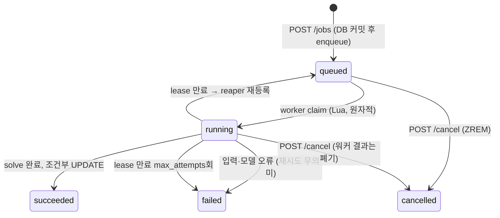

# 설계 결정

## 1. 작업 생명주기

| 결정 | 이유 |
|---|---|
| DB가 상태 원본, Redis는 스케줄링만 | Redis가 날아가도 작업 기록·결과는 남는다. Redis는 "누가 다음에 무엇을 돌릴지"만 안다. |
| DB 커밋 → enqueue 순서 | 반대 순서면 워커가 아직 커밋 안 된 작업을 집을 수 있다. enqueue 실패 시 작업을 `failed`로 표시해 유령 작업을 남기지 않는다. |
| 워커의 DB 갱신은 `WHERE id AND attempt AND status='running'` | lease가 만료돼 다른 워커가 같은 작업을 다시 가져갔거나 사용자가 취소했으면, 늦게 끝난 워커의 결과는 0행 갱신으로 자연히 버려진다. 분산 락 없이 멱등성 확보. |

## 2. 큐

| 결정 | 대안 | 이유 |
|---|---|---|
| Redis ZSET + Lua 직접 구현 | Celery, RQ, arq | 사용자별 동시 실행 한도와 fair queuing을 claim 시점에 원자적으로 판단해야 한다. 범용 큐는 "꺼낸 뒤 한도 초과면 되돌리기"가 되어 경합 시 순서가 깨지고 불필요한 왕복이 생긴다. 스크립트 4개(enqueue, claim, release, reap)라 유지 부담이 작다. |
| lease + heartbeat | ack 기반 visibility timeout | 최적화 작업은 수 초~2분. heartbeat가 lease를 연장하므로 긴 작업도 회수되지 않고, 워커가 죽으면 `lease_seconds` 안에 다른 워커가 회수한다. |
| 시도 횟수 상한 (`max_attempts`) | 무한 재시도 | 특정 입력이 solve 프로세스를 죽이는 경우(OOM 등) 워커를 계속 쓰러뜨리는 독약 작업을 막는다. |
| 입력·모델 오류는 즉시 `failed` | 재시도 | 같은 입력은 같은 결과. 재시도는 프로세스 비정상 종료(`BrokenProcessPool`)에만 적용한다. |

### fair queuing

pending score = `(9 - priority) × 10^13 + 가상 시작 시각`.

사용자마다 가상 시각 `vt`를 두고, 작업을 넣을 때 `start = max(now, vt_user)`, `vt_user = start + 예상 실행 시간(time limit)`.

- 한 사용자가 작업 20개를 몰아 넣으면 그 작업들의 가상 시작 시각이 time limit 간격으로 벌어진다.
- 나중에 온 사용자의 첫 작업은 `now`에 놓여 그 사이로 들어간다.
- 무거운 작업(긴 time limit)을 넣는 사용자는 그만큼 뒤로 밀린다 → 자원 사용량 기준 공정성.
- 우선순위 구간이 먼저 비교되므로 긴급(9) 작업은 공정성보다 앞선다.

부하 테스트에서 사용자별 첫 작업 최대 대기가 19.0s → 5.4s로 줄었다.

### 사용자별 동시 실행 한도

claim 스크립트가 pending 앞쪽부터 훑으며 `user_running < limit`인 첫 작업을 꺼낸다. 한도에 걸린 사용자의 작업은 건너뛰므로 한 사용자가 워커 슬롯을 독점하지 못한다.
한도는 `user_limit` HASH(관리자 API로 설정)에 있고, 없으면 기본값.

## 3. 워커와 CPU 자원

| 결정 | 이유 |
|---|---|
| solve는 `ProcessPoolExecutor` | CP-SAT은 CPU 바운드. 이벤트 루프 스레드에서 돌리면 heartbeat가 멈춰 lease가 만료된다. 프로세스 분리로 solve 크래시가 워커를 죽이지 않는다. |
| `worker_slots × solver_threads ≤ 코어 수` | CP-SAT은 멀티스레드 portfolio 탐색. 슬롯과 스레드를 곱한 값이 코어를 넘으면 모든 작업이 같이 느려진다. 처리량(슬롯↑) vs 개별 품질(스레드↑) 조절 지점. |
| 수평 확장 = 워커 컨테이너 수 | 워커는 상태가 없다. compose `replicas`, Kubernetes Deployment 그대로 늘리면 된다. |
| graceful shutdown | SIGTERM 시 새 claim을 멈추고 실행 중 작업을 마친다 (`stop_grace_period: 2m`). 배포 중 작업 유실 없음. |

## 4. 인증과 MCP

| 결정 | 이유 |
|---|---|
| MCP 서버는 상태 없는 API 클라이언트 | 인증·할당량·큐를 한 곳(백엔드)에서만 관리. MCP 서버 장애가 작업 상태에 영향을 주지 않는다. |
| HTTP 모드에서 호출자 토큰 전달 | 공용 서비스 계정으로 붙이면 모든 사용자가 한 할당량을 나눠 쓰고 작업 소유권이 사라진다. MCP 서버는 호출자 Bearer 토큰을 백엔드 `/auth/me`로 검증하고, tool 호출에도 그 토큰을 그대로 쓴다. JWT 비밀키를 MCP 서버와 공유하지 않는다. |
| 타인 작업은 404 | 403이면 작업 id 존재 여부가 드러난다. |
| PBKDF2 해시는 스레드에서 | 24만 회 반복은 수백 ms CPU. 이벤트 루프에서 돌리면 동시 요청 전체가 멈춘다 (부하 테스트에서 제출 p95 4.4s의 원인). |
| 운영 모드에서 기본 JWT 키 거부 | 기본값으로 배포되는 사고 방지. 32자 미만이면 기동 실패. |

## 5. 최적화 모델

| 결정 | 이유 |
|---|---|
| CP-SAT (제약 프로그래밍) | 세팅 시간이 순서에 따라 달라지는 스케줄링은 MIP보다 CP가 강하다. interval·no-overlap·circuit을 직접 표현할 수 있다. |
| 세팅 시간은 설비별 circuit | 연속한 두 작업 사이 간격을 강제하려면 "누가 바로 다음인지"를 알아야 한다. 세팅이 필요 없는 설비는 circuit을 생략해 모델을 줄인다. |
| 기준 휴리스틱 해를 hint로 | 초기 해를 즉시 확보해 time limit이 짧아도 최소한 규칙 수준 이상을 보장. |
| 결과 독립 검증 | 모델 버그로 제약을 어긴 일정이 현장에 나가는 것을 막는 마지막 방어선. 테스트에서도 같은 검증기를 쓴다. |
| 착수 작업 고정, 충돌 시 해제 | 재계산 때 이미 돌고 있는 작업을 옮기면 현장에서 쓸 수 없다. 단, 고정 작업이 새 고장 구간과 겹치면 물리적으로 불가능하므로 고정을 풀고 `released_frozen`으로 알린다. |
| 목적함수 가중합 | 납기 지연(가중) 우선, 동률이면 빨리 끝나는 쪽. 가중치는 요청마다 조절 가능. |

## 6. LLM agent

| 결정 | 이유 |
|---|---|
| tool 목록은 MCP 서버에서 그대로 가져온다 | agent 전용 tool 정의를 따로 두면 MCP 서버와 어긋난다. 같은 `ToolProvider` 인터페이스로 in-process 서버(평가)와 원격 세션(운영)을 바꿔 끼운다. |
| 직접 짠 tool-use 루프 | 평가에 턴 수·tool 호출·토큰·지연 trace가 필요하고, refusal·max_tokens 같은 종료 사유를 케이스 결과로 남겨야 한다. |
| 이력 append-only, 응답 content 그대로 되돌림 | thinking block은 생성된 대화에서만 유효하다. 텍스트만 뽑아 다시 넣으면 다음 요청에서 깨진다. |
| system prompt 고정 + `cache_control`, tool 정의 이름순 정렬 | prompt cache는 접두어 일치. 현재 시각처럼 바뀌는 값은 system이 아니라 사용자 메시지에 붙인다. |
| 강제 `tool_choice` 없음 | 기본 모델은 `any`/`tool` 강제를 받지 않는다. 언제 되묻고 언제 제출할지는 system prompt로 정한다. |
| `fallbacks: "default"` | 안전 분류기 오탐으로 거절되면 서버 측에서 권장 모델로 재시도한다. 그래도 거절이면 `refusal`로 끝내고 trace에 남긴다. |
| tool 오류는 `is_error`로 모델에 돌려준다 | 스키마 오류·잘못된 job id를 모델이 보고 스스로 고친다. 예외로 루프를 끊지 않는다. |

### 평가

- 정답을 아는 문제(generator)를 한국어 지시문으로 풀어 쓰고, agent가 tool에 넘긴 입력을 원 문제와 필드 단위로 비교한다. 채점에 LLM을 쓰지 않아 결과가 결정적이고 비용이 없다.
- 하네스·채점기 자체의 버그가 점수로 둔갑하지 않도록 두 방향을 테스트한다: 정답 호출(oracle)은 전부 통과, 일부러 틀린 입력은 해당 검사에서 실패.
- 케이스마다 별도 사용자로 실행해 할당량·소유권까지 실제 경로를 탄다.

## 7. 소요 시간 예측과 GPU 큐

| 결정 | 이유 |
|---|---|
| 예측 대상은 `log(실제 / 계획)` | 계획 시간에 곱하는 보정 배율이라 수량 규모와 무관하게 학습되고, 못 본 설비·제품은 평균 보정으로 자연스럽게 떨어진다. |
| 학습은 torch, 추론은 numpy | 학습은 gpu 큐 워커에서만 한다. 일정 최적화 워커는 저장된 가중치(JSON)로 numpy 순전파만 하므로 torch 없이 가볍게 유지된다. |
| 자원 클래스 = 큐 | 작업 kind가 큐(cpu/gpu)를 정한다. cpu 작업이 아무리 밀려도 학습 작업 슬롯을 뺏지 않고, 반대도 마찬가지. 같은 fair queuing·사용자 한도·lease가 그대로 적용된다. |
| gpu 워커는 장치 풀 | 장치마다 슬롯 1개. 작업이 시작할 때 장치를 빌리고 끝나면 돌려준다. 한 장치에 두 학습이 겹치지 않는다. |
| 모델 저장과 작업 완료를 한 트랜잭션 | 회수되거나 취소된 학습의 늦은 결과는 작업 갱신이 0행이 되고, 모델 행도 함께 롤백된다. |
| 모델은 사용자 소유 | 남의 모델 id로 일정을 요청하면 제출 시점(422)과 실행 시점 모두에서 막는다. |
| 효과는 '실제 실행'으로 잰다 | 예측 정확도(MAPE)만으로는 계획이 좋아졌는지 알 수 없다. 두 계획을 같은 시뮬레이터에서 실행해 실제 납기 지연을 비교한다. |

## 8. 운영

| 결정 | 이유 |
|---|---|
| Alembic, 별도 migrate 단계 | 앱 기동 시 `create_all`은 컬럼 변경을 못 하고 여러 인스턴스가 동시에 돌린다. 운영은 migrate 컨테이너가 끝난 뒤 api·워커가 뜬다. `create_all`은 개발·테스트 전용. |
| CI에서 `alembic check` | 모델을 바꾸고 마이그레이션을 빼먹으면 실패한다. |
| HTTP 지표 라벨은 경로 템플릿 | `/jobs/{job_id}` 단위로 묶는다. 실제 id를 라벨로 쓰면 시계열이 무한히 늘어난다. |
| 큐 길이는 스크레이프 시점에 Redis에서 | 워커마다 세면 중복·누락이 생긴다. 원본 한 곳에서 읽는다. |
| 워커 지표는 별도 포트 | 워커는 HTTP 서버가 없다. `FSA_METRICS_PORT`로 노출하고 Prometheus가 compose DNS로 모든 레플리카를 찾는다. |
